# STAGE 2: MULTIMODAL ARCHITECTURE PROPOSAL — TESTPILOT AI
**Design Principle:** *Zero disruption to deterministic DOM verification; additive multimodal intelligence for Meta Muse Spark Open.*

---

## 1. End-to-End Multimodal Pipeline

```mermaid
flowchart LR
    A["Playwright observe()"] -->|"1280x800 PNG (~18KB) + DOM JSON"| B["Image Prep & Budget Guard"]
    B -->|"data:image/png;base64 (Selective: Plan + Post-Submit)"| C["Meta Muse Spark Open (816B-A42B)"]
    C -->|"AgentDecision JSON (action + reasoning + visualObservation)"| D["Zod Validation & Grounding Engine"]
    D -->|"Playwright Action / Assertion"| E["Evidence-Backed HTML Report"]
```



### How Each Stage Preserves Existing Guarantees

1. **Stage 1 — Playwright Screenshot Capture (Already Implemented):**
   - `BrowserExecutor.observe()` (`src/lib/browser/executor.ts:125`) already captures a `1280x800` viewport PNG (`fullPage: false`) to `.data/screenshots/<timestamp>-observe.png`.
2. **Stage 2 — Image Preparation & Selective Attachment (`src/lib/ai/modal.ts`):**
   - **No New Dependencies:** Uses Node's built-in `node:fs` to read `.data/${observation.screenshotPath}` and encode as `data:image/png;base64,...` (identical to `src/lib/reporting/html.ts:10-12`).
   - **Payload Cap & Graceful Fallback:** Checks file size before encoding (`stat.size <= 250_000` bytes). If the file is missing, unreadable, exceeds 250 KB, or if the Modal endpoint rejects multimodal content, it transparently falls back to the existing text-only message format.
   - **Selective Transmission (Token & Latency Guard):** Instead of sending images on every `fill` step (where the page layout hasn't changed), images are attached **only** when:
     1. `planTests()` is called (initial visual inspection of the page layout), OR
     2. The previous step in `history` was a state-changing interaction (`click`, `navigate`, or a failed `assert_*`).
     This limits multimodal vision calls to **2–3 per run** instead of 13–15.
3. **Stage 3 — Multimodal Request Format (`src/lib/ai/modal.ts`):**
   - Updates `ChatMessage` internal type in `modal.ts`:
     ```ts
     type ChatContentPart =
       | { type: "text"; text: string }
       | { type: "image_url"; image_url: { url: string } };
     type ChatMessage = { role: string; content: string | ChatContentPart[] };
     ```
   - When an image is attached, the `user` message uses `content: [{ type: "text", text: promptText }, { type: "image_url", image_url: { url: dataUrl } }]`.
4. **Stage 4 — Structured Visual Observations (`src/lib/schemas/index.ts`):**
   - Adds one optional field to `AgentDecisionSchema`:
     ```ts
     export const AgentDecisionSchema = z.object({
       reasoning: z.string().max(1000),
       visualObservation: z.string().max(500).optional(),
       action: AgentActionSchema,
     });
     ```
   - This is 100% backward-compatible: `MockModelAdapter` and all 26 existing unit/integration tests continue to pass without modification because `visualObservation` is `.optional()`.
5. **Stage 5 — Grounding & Finding Classification (`src/lib/agent/runner.ts`):**
   - **Strict Epistemic Boundary Maintained:**
     - **Confirmed Findings:** Still require a failed Playwright assertion (`assert_text`, `assert_url`, `assert_visible`) whose expected value is grounded in the user's `objective` or `instructions`.
     - **Suspected Visual Findings:** Visual observations alone **never** produce a `confirmed` defect, preventing vision hallucinations from corrupting the oracle. Instead, `visualObservation` is recorded in the timeline (`kind: "reason"`) and displayed in the UI and HTML report under `Rationale:`, proving to hackathon judges that Muse Spark Open is actively inspecting the live pixels.

---

## 2. Exact Code Changes Required (Minimal Footprint)

If approved, the entire extension touches **only 3 files (~45 lines of code total)**:

| File | Change Description | Lines Changed | Risk |
|---|---|---:|---|
| [`src/lib/schemas/index.ts`](file:///c:/Users/wkhal/Documents/TestPilot-AI/src/lib/schemas/index.ts#L111-L115) | Add optional `visualObservation: z.string().max(500).optional()` to `AgentDecisionSchema`. | +1 line | Zero (optional field) |
| [`src/lib/ai/modal.ts`](file:///c:/Users/wkhal/Documents/TestPilot-AI/src/lib/ai/modal.ts#L61-L116) | 1. Allow `content: string \| ChatContentPart[]` in `chat()`.<br>2. Add helper `loadScreenshotDataUrl(screenshotPath?: string): string \| null` (reads `.data/<path>` if `<= 250KB`).<br>3. Attach `image_url` part in `planTests()` and selectively in `nextAction()` (when initial step or after `click`/`navigate`/failed assertion), with automatic fallback to text-only if multimodal call fails.<br>4. Ask model to include brief `visualObservation` in `nextAction` JSON when an image is provided. | ~35 lines | Low (wrapped in try/catch fallback to text-only) |
| [`src/lib/agent/runner.ts`](file:///c:/Users/wkhal/Documents/TestPilot-AI/src/lib/agent/runner.ts#L190-L192) & [`src/app/runs/[id]/page.tsx`](file:///c:/Users/wkhal/Documents/TestPilot-AI/src/app/runs/%5Bid%5D/page.tsx#L87-L95) | Include `visualObservation` in the `reason` timeline event data and render a `"Visual observation: ..."` line under `Rationale:` in the Run UI. | ~10 lines | Very Low |

---

## 3. Privacy, Redaction, and Safety Controls

1. **Synthetic Data Policy:** Project creation already instructs the agent to use synthetic test data only, and `runner.ts:270` redacts filled values in reproduction steps.
2. **Selective Screenshot Transmission:** Screenshots are **not** sent to the model immediately after `fill` actions (while typing into input fields)—they are only sent on initial page load (`planTests`) and after form submission (`click`), minimizing unnecessary exposure of intermediate form states.
3. **Hard Token & Cost Guard:** Existing `run.tokenUsage.totalTokens > project.maxTokens` (`runner.ts:156`) counts all vision tokens billed by Modal (`usage.prompt_tokens`) and stops the run if the budget is exceeded.
4. **Automatic Text-Only Fallback:** If a multimodal request throws an HTTP 400/422 or schema error, `modal.ts` immediately retries the exact same turn using text-only content so the run never fails due to vision formatting.
